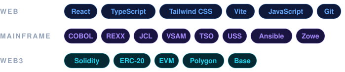
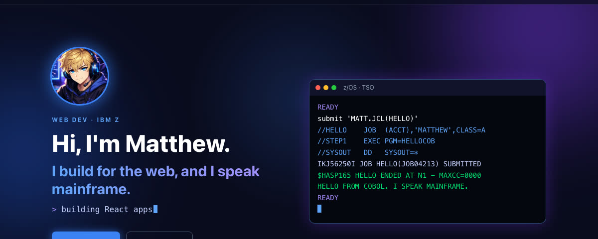
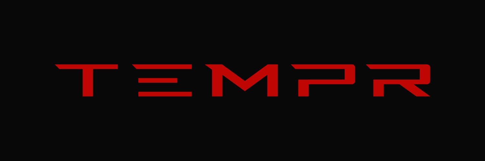
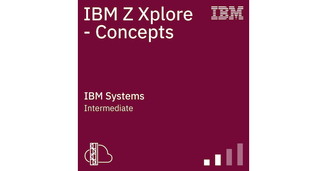
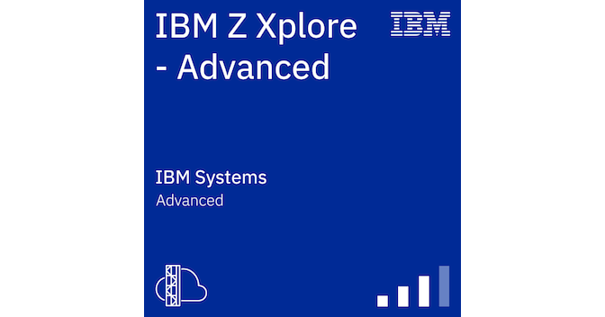

  

   

  
  
  
  

## 👋 About

I got into coding when I realized that every system is built on code, from the COBOL running behind banks to the websites we use every day. I build modern sites with React and TypeScript, and I'm drawn to mainframes because that's where most of the world's data flows. I've also deployed my own ERC-20 tokens on Polygon and Base, and I'm working toward building on Solana. These days I spend my time going deep on all three: shipping web projects, earning IBM Z certifications, and experimenting on-chain. I'm open to freelance work.

## ⚡ Stack

## 🚀 Featured

<table>
  <tr>
    <td width="50%" valign="top">
      
      <h3>Developer Portfolio</h3>
      
This profile's big sibling: a dark-neon, single-page portfolio with projects, certifications, and contact. Data-driven and auto-deployed on every push.

      
<b>React · TypeScript · Tailwind · Vite · GitHub Actions</b>

      <a href="https://0xmattyic333.github.io">Live site →</a> · <a href="https://github.com/0xmattyic333/0xmattyic333.github.io">Code →</a>
    </td>
    <td width="50%" valign="top">
      
      <h3>TEMPR Esports: WolfeePackk</h3>
      
Official site for an esports team and streamer: live streams, team roster, weekly stream schedule, YouTube content, merch, and Discord.

      
<b>React · Vite · GitHub Pages · GoatCounter</b>

      <a href="https://0xmattyic333.github.io/wolfeepackk_temprgg/">Live site →</a> · <a href="https://github.com/0xmattyic333/wolfeepackk_temprgg">Code →</a>
    </td>
  </tr>
  <tr>
    <td width="50%" valign="top">
      
      <h3>Web3 experiments: ERC-20 tokens</h3>
      
Personal experiments deploying my own ERC-20 tokens to two EVM networks, RecklessAndRelentless (RAR) on Polygon and LonelyInLorain (LIL) on Base, to learn the contract deploy flow end to end.

      
<b>Solidity · ERC-20 · Polygon · Base · EVM</b>

      <a href="https://polygonscan.com/token/0x0259ddfBD48e65C22Ca365bc32AFF5B0a5fB9567">RAR on PolygonScan →</a> · <a href="https://basescan.org/token/0xF3007d8719741Cc361Dc7571120c01CE207fC772">LIL on BaseScan →</a>
    </td>
    <td width="50%" valign="top">
      <h3>🔜 Next up</h3>
      
Building on <b>Solana</b>, and more client sites. Watch this space.

    </td>
  </tr>
</table>

## 🏅 Certifications

<table>
  <tr>
    <td align="center" width="50%">
      
       <b>IBM Z Xplore – Concepts</b>
       JCL · data sets · USS · Python · Z Open Automation
       <a href="https://www.credly.com/badges/ec0ccf1b-09aa-4bd9-b675-55939a8fdb3e/public_url">Verify on Credly →</a>
    </td>
    <td align="center" width="50%">
      
       <b>IBM Z Xplore – Advanced</b>
       REXX · COBOL · VSAM · TSO · Ansible · Zowe · Docker
       <a href="https://www.credly.com/badges/493849b8-9eff-44a1-b8fb-5f0c9902b1e6/public_url">Verify on Credly →</a>
    </td>
  </tr>
</table>

  

